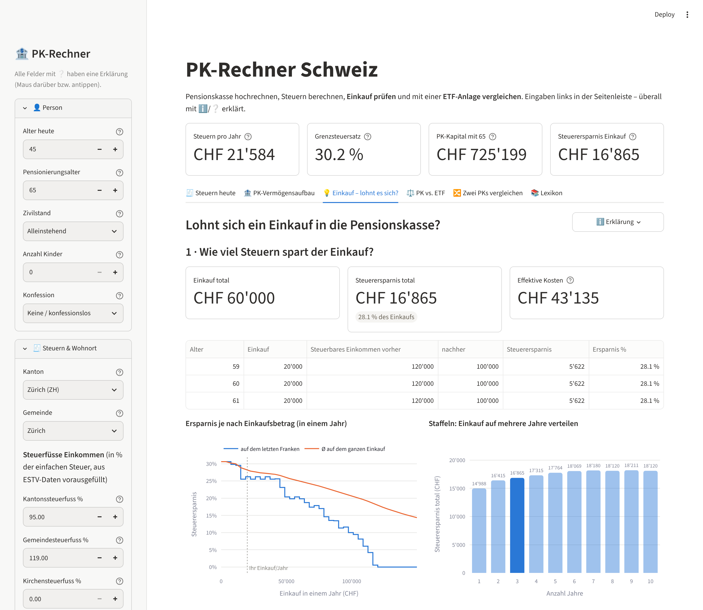

# 🏦 PK-Rechner Schweiz

Streamlit-App rund um die **Pensionskasse (2. Säule)**: Altersguthaben hochrechnen, Steuern
berechnen, **PK-Einkauf** prüfen und mit einer **ETF-Anlage** vergleichen. Alle Eingaben sind mit
Info-Buttons erklärt, auch für PK-Laien.



## Funktionen

| Tab | Was Sie sehen |
|---|---|
| 🧾 **Steuern heute** | Einkommens- und Vermögenssteuer für Bund, Kanton, Gemeinde und Kirche. Dazu Grenz- und Durchschnittssteuersatz (mit Kurve), eine Tabelle der Kapitalbezugssteuer und ein Vergleich aller Gemeinden im Kanton |
| 🏦 **PK-Vermögensaufbau** | Hochrechnung bis zur Pensionierung (Beiträge AN/AG, Zinsen, Einkäufe), die Zusammensetzung des Kapitals, Rente vs. Kapital mit Break-even-Alter und ein CSV-Export |
| 💡 **Einkauf – lohnt es sich?** | Steuerersparnis des Einkaufs, Wirkung der Progression, Staffelung über mehrere Jahre und der Vergleich Einkauf vs. ETF. Dazu **ab welchem Alter** und **ab welchem Einkommen** sich ein Einkauf lohnt, die Break-even-Rendite und die effektive Rendite des Einkaufs |
| ⚖️ **PK vs. ETF** | Weniger in die PK einzahlen (z.B. Wahlplan) und die Differenz nach Steuern ins ETF investieren. Mit Sensitivität zur ETF-Rendite |
| 🔀 **Zwei PKs vergleichen** | Zwei Pensionskassen oder Sparpläne vergleichen, z.B. bei einem Stellenwechsel. Ein Lohnunterschied ist möglich, und die Nettolohn-Differenz wird fair im ETF angelegt |
| 📚 **Lexikon** | Alle Begriffe einfach erklärt (Umwandlungssatz, Koordinationsabzug, Sperrfrist …) |

### Steuerberechnung

* **ESTV-Tarife 2026** von Bund und allen 26 Kantonen, mit den **Steuerfüssen aller ~2'100 Gemeinden**.
  Diese sind vorausgefüllt und lassen sich anpassen (Kanton, Gemeinde, Kirche).
* Tarifarten: Zürcher Stufentarif, Bundestarif, Flat-Tax, Freiburger Satztarif und Formeltarife (BL).
  Splitting für Verheiratete und Alleinerziehende ist berücksichtigt.
* Die Vermögenssteuer rechnet mit den kantonalen Freibeträgen.
* Die **Kapitalbezugssteuer** folgt den kantonalen Regeln: eigener Vorsorgetarif, Bruchteil des Tarifs,
  Rentensatz, Minimal- und Maximalsätze. Bund: 1/5 des Tarifs.
* Validierung: Die Portierung reproduziert die Referenztests des Originalprojekts exakt. Mit
  publizierten Vergleichswerten abgeglichen sind Zug, Stadt Zürich, Appenzell I.Rh., Schwyz, Appenzell A.Rh.
  und weitere Kantonshauptorte (siehe `tests/`).

## Starten

```bash
pip install -r requirements.txt
streamlit run app.py
```

Tests:

```bash
pip install -r requirements-dev.txt
pytest
```

### Online stellen (gratis)

1. Auf [share.streamlit.io](https://share.streamlit.io) mit GitHub anmelden.
2. **New app** → dieses Repository, Branch und `app.py` wählen → **Deploy**.

## Methodik & Annahmen

* **Eingabe** ist das *steuerbare* Einkommen gemäss Steuererklärung. Die heutigen PK-Lohnabzüge sind darin
  bereits abgezogen. Für die Bundessteuer kann ein abweichender Wert erfasst werden.
* **Zeithorizont**: wahlweise über das Pensionierungsalter oder direkt über die verbleibenden Arbeitsjahre.
* **PK**: Beiträge und Einkäufe werden Ende Jahr gutgeschrieben. Verzinst wird das Guthaben zu Jahresbeginn,
  mit konstantem Zins- und Umwandlungssatz. Die Beiträge sind als Fixbeträge oder als Altersstaffel erfassbar.
* **Einkauf vs. ETF**: Beide Varianten setzen gleich viel eigenes Geld ein. Bei der PK fällt die zusätzliche,
  progressive Kapitalbezugssteuer an. Die Steuerersparnis wird optional im ETF angelegt.
* **ETF**: Rendite vor Kosten. Dividenden werden jährlich zum Grenzsteuersatz besteuert, und auf dem Depotwert
  fällt zusätzlich Vermögenssteuer an. Diese Steuern werden aus dem Depot bezahlt. Kursgewinne sind steuerfrei.
* **Vergleiche** gehen von einem Kapitalbezug bei Pensionierung aus und rechnen in nominalen Franken.

### Bekannte Vereinfachungen

* Personal-/Kopfsteuern fehlen, und das Konkubinat wird wie alleinstehend behandelt.
* Bei den Kapitalbezugsregeln von **Waadt, Wallis und Tessin** gab es keinen aktuellen Abgleich; die Werte
  liegen eher zu hoch. In der App lässt sich deshalb ein **Korrekturfaktor** setzen (Abgleich mit dem
  [ESTV-Rechner](https://swisstaxcalculator.estv.admin.ch)).
* Wallis: Die Indexierung (173 %) wird angenähert, die Ermässigung für Verheiratete fehlt.
* Nicht berücksichtigt sind Schwankungs- und Sequenzrisiko, Risikoleistungen (Tod/Invalidität),
  Teuerungsanpassung der Tarife, WEF-Vorbezüge und die Quellensteuer.

> ⚠️ Der Rechner dient der Orientierung und ersetzt keine Steuer- oder Vorsorgeberatung. Massgebend sind das
> Reglement Ihrer Pensionskasse und die Veranlagung Ihrer Steuerbehörde.

## Projektstruktur

```
app.py                    Streamlit-Oberfläche
pkcalc/tax.py             Steuer-Engine (Einkommen, Vermögen, Kapitalbezug)
pkcalc/pension.py         PK-Hochrechnung, BVG-Eckwerte 2026
pkcalc/analysis.py        Einkauf, PK vs. ETF, Zwei-PK-Vergleich, Rente vs. Kapital
pkcalc/texts.py           Erklärtexte, Info-Buttons, Lexikon
data/tax_data_2026.json   ESTV-Steuerdaten 2026 (kompakt)
tools/build_tax_data.py   Erzeugt die Datendatei aus den ESTV-Rohdaten
tests/                    pytest-Tests
```

## Datenquellen

* Steuertarife, Steuerfüsse und Abzüge: Eidgenössische Steuerverwaltung (ESTV), aufbereitet durch
  [devbrains-com/swisstaxcalculator](https://github.com/devbrains-com/swisstaxcalculator) (MIT-Lizenz),
  siehe [THIRD_PARTY_NOTICES.md](THIRD_PARTY_NOTICES.md).
* BVG-Eckwerte 2026: Koordinationsabzug CHF 26'460, Eintrittsschwelle CHF 22'680, Mindestzins 1.25 %.
